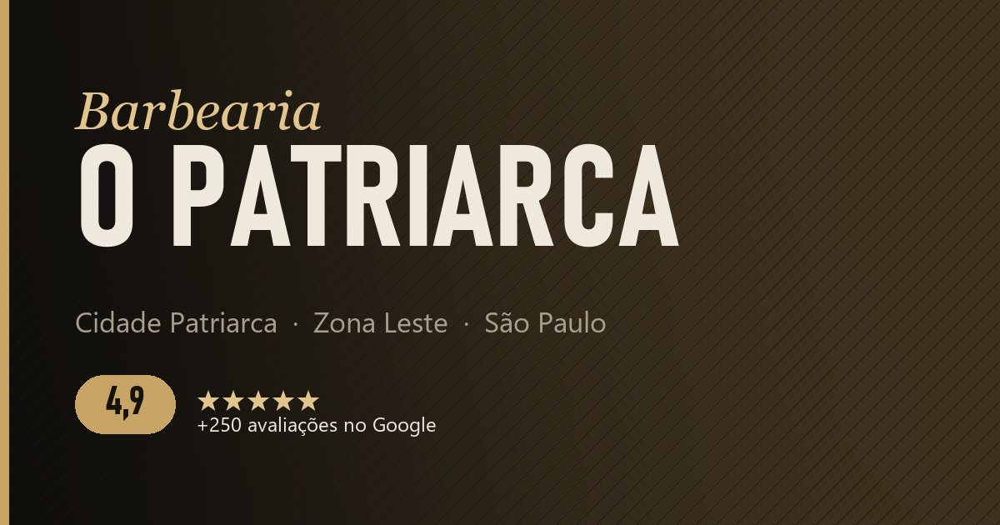

<div align="center">



# Barbearia O Patriarca · Site oficial

**Landing page da barbearia O Patriarca, na Cidade Patriarca, zona leste de São Paulo.**
Projeto de extensão universitária do curso de Análise e Desenvolvimento de Sistemas (USJT).


[**Ver o site**](https://passetti-cmd.github.io/barbearia-o-patriarca/) · [Publicar](documentação/COMO_PUBLICAR.md) · [Onde editar](documentação/ONDE_EDITAR.md) · [Medição](documentação/MEDICAO.md)

</div>

---

## Sobre o projeto

A barbearia tem nota **4,9 no Google com mais de 250 avaliações**, mas a presença online dependia só do Instagram e do Booksy. Este site dá a ela um endereço próprio, pensado para:

| Objetivo | Como o site resolve |
| --- | --- |
| Presença digital própria | Página única, rápida, com a cara da marca |
| Portfólio dos cortes | Galeria em grade com lightbox (toque para ampliar, deslize para trocar) |
| Aparecer no Google local | SEO focado em *barbearia Cidade Patriarca / zona leste / metrô Patriarca*, dados estruturados `BarberShop`, sitemap |
| Imagem mais premium | Visual escuro com dourado, tipografia condensada forte, animações leves |
| Levar ao agendamento | Botões de **Agendar (Booksy)** e **WhatsApp** em todas as seções + botão flutuante |

## Seções

1. **Hero:** nome, frase de posicionamento, selo 4,9 no Google, botões de agendar e WhatsApp, aviso "Aberto agora / Fechado".
2. **Serviços:** 3 destaques em cards + tabela completa em abas (Cortes, Barba, Combos, Acabamentos) com os preços do Booksy.
3. **Portfólio:** 8 fotos em grade com lightbox acessível.
4. **Sobre:** texto da barbearia, diferenciais e equipe.
5. **Avaliações:** destaque da nota, botão "Avalie a gente no Google" e espaço para colar avaliações **reais**.
6. **Localização:** endereço, metrô Patriarca, horário, botão de rota e mapa do Google.
7. **Rodapé:** contatos, endereço e crédito do projeto de extensão.
8. **WhatsApp flutuante** fixo no canto da tela.

## Destaques técnicos

- **Zero dependências e zero build.** HTML, CSS e JS puros. Abre direto no navegador e publica no GitHub Pages sem configurar nada.
- **Mobile-first.** Pensado primeiro para quem chega pelo Instagram no celular: botões com no mínimo 48 px, menu em tela cheia, abas que cabem na tela.
- **Leve.** Sem frameworks nem bibliotecas; imagens com `loading="lazy"`, `width`/`height` definidos (sem "pulos" de layout) e mapa carregado sob demanda.
- **Movimento que não trava.** Animações só com `transform`/`opacity`, `IntersectionObserver` para revelar seções, e tudo desligado para quem ativa *reduzir movimento* no sistema.
- **Acessível.** Um único `h1`, hierarquia de títulos correta, link "pular para o conteúdo", foco visível, abas no padrão ARIA (setas do teclado), lightbox com `<dialog>` (Esc fecha, setas trocam foto, foco volta para a miniatura), contraste AA.
- **SEO local.** `title` e `description` focados na região, JSON-LD `BarberShop` (endereço, horário, nota, serviços com preço, `sameAs`), Open Graph e Twitter Card, `sitemap.xml` com imagens, `robots.txt`, `canonical`.
- **Seguro.** Nenhuma chave, senha ou token no código. *Content Security Policy* restringe o que a página pode carregar, links externos com `rel="noopener noreferrer"`, `.gitignore` bloqueando arquivos `.env`.
- **Medição sem cookies.** GoatCounter opcional (vem desligado) contando visitas e cliques em Agendar, WhatsApp e Avaliar.

## Estrutura

```
2026-10__barbearia_o_patriarca/
├── index.html              # a página inteira (conteúdo + SEO + JSON-LD)
├── 404.html                # página de erro com a cara do site
├── robots.txt              # libera buscadores e aponta o sitemap
├── sitemap.xml             # mapa do site para o Google
├── site.webmanifest        # ícone e cores ao "adicionar à tela inicial"
├── .nojekyll               # GitHub Pages serve os arquivos como estão
├── assets/
│   ├── css/style.css       # estilos (tokens de cor no topo)
│   ├── js/main.js          # interações + CONFIG (GoatCounter e horários)
│   └── img/
│       ├── portfolio/      # corte-01.jpg … corte-08.jpg (fotos reais otimizadas)
│       ├── equipe/         # barbeiro-01.jpg, barbeiro-02.jpg
│       ├── logo/           # logo dourado com fundo transparente (WebP)
│       ├── icons/          # favicon e ícones do app (feitos do logo)
│       └── og-image.jpg    # imagem da prévia no WhatsApp/Instagram
├── scripts/
│   └── preparar_imagens.py # recorta/comprime fotos e gera logo, ícones e og-image
├── documentação/
│   ├── COMO_PUBLICAR.md    # passo a passo GitHub Pages + Google
│   ├── ONDE_EDITAR.md      # textos, preços, fotos, horários
│   ├── MEDICAO.md          # GoatCounter e eventos para o relatório
│   └── CONFIRMAR_COM_O_DONO.md # dados confirmados e decisões
├── fotos_originais/        # fotos em alta (fora do Git)
├── notas.txt
└── resumo.txt
```

## Rodando localmente

Não precisa instalar nada. Para ver exatamente como vai ficar no ar, sirva a pasta com um servidor simples:

```bash
python -m http.server 8000
```

Depois abra `http://localhost:8000`.

## Status

No ar e com os dados confirmados com a barbearia (horário, contato, equipe, preços e fotos). Detalhes e decisões em [CONFIRMAR_COM_O_DONO.md](documentação/CONFIRMAR_COM_O_DONO.md).

## Créditos

Desenvolvido por **[Erick Passetti](https://github.com/passetti-cmd)** – Projeto de Extensão USJT, 2026.
Conteúdo, marca e fotos pertencem à Barbearia O Patriarca.
